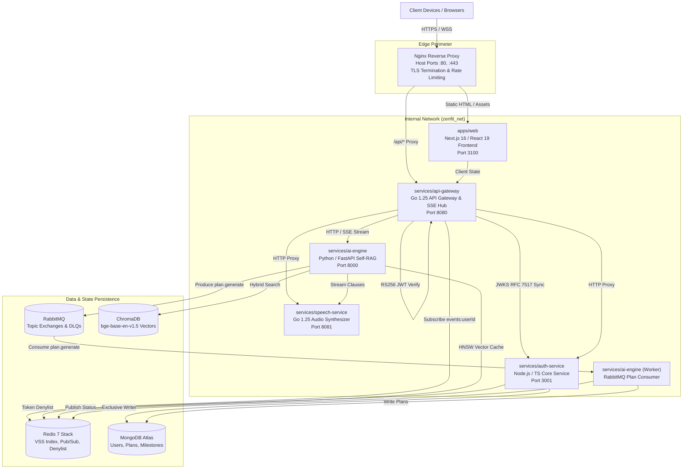
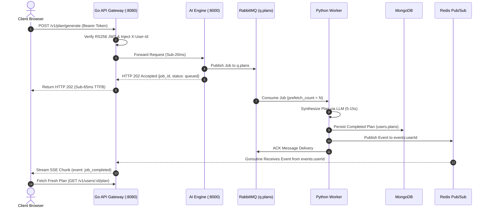
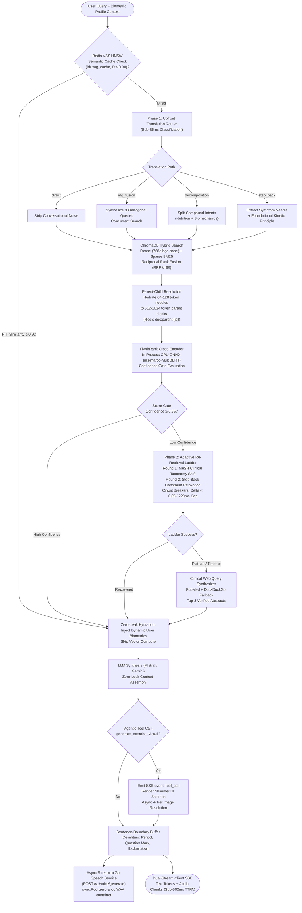

# ZenFit — Distributed Multimodal AI Fitness & Health Platform

<div align="center">


**A high-performance, distributed microservices platform for real-time multimodal fitness coaching.**  
Engineered with an Agentic Self-RAG engine, sub-millisecond semantic caching, low-memory Go services, zero-trust asymmetric authentication, and resilient asynchronous job processing.

[System Architecture](#-system-architecture) • [Self-RAG Pipeline](#-agentic-self-rag-architecture) • [Benchmarks](#-empirical-benchmarks--test-results) • [Trade-Offs](#-architectural-trade-offs--decision-rationale) • [Resilience](#-fault-tolerance--failure-recovery) • [Security](#-multi-tenant-privacy--zero-trust-perimeter) • [Local Setup](#-local-setup--quickstart)

</div>

---

## 📖 Overview

ZenFit is a distributed multimodal coaching platform designed to overcome the latency, privacy, and reliability limitations of monolithic AI applications. The system decouples compute-intensive machine learning workflows from edge request routing through four specialized microservices:

1. **Go API Gateway & SSE Hub**: High-throughput reverse proxy, JWT edge sanitization, sliding-window rate limiting, and real-time event streaming.
2. **Go Speech & Audio Service**: Stateless audio microservice delivering raw binary audio streaming with zero-allocation buffer pools (`sync.Pool`).
3. **Python AI Engine & Workers**: Next-Gen Agentic Self-RAG pipeline featuring RediSearch HNSW semantic caching, in-process CPU ONNX cross-encoders, adaptive re-retrieval ladders, and asynchronous RabbitMQ plan generation.
4. **Node.js Auth & Core Service**: Single-owner database boundary for MongoDB, minting asymmetric RS256 JWT tokens with RFC 7517 dynamic JWKS key discovery.

---

## ⚡ Empirical Benchmarks & Test Results

All benchmarks were measured locally on a Windows 11 workstation powered by an **Intel Core i5-12500H (16 vCPUs, 16GB RAM)** across Go (`cmd/bench/main.go`) and Python (`bench/bench.py`) test harnesses. 

> **Hardware & Environment Note**: Because these metrics were empirically recorded on a local developer machine, throughput and latency figures will naturally vary across different processor architectures, available cores, container hypervisors, and cloud networking environments.

### Core System Performance

| Component / Endpoint | Metric Tested | Result | Latency Profile | SLA / Target Budget |
| :--- | :--- | :---: | :---: | :---: |
| **Go API Gateway** (`/health/live`) | Core Router Multiplexing | **3,819.2 req/s** | P50: **7.54 ms** | Sub-10 ms |
| **Go Gateway Auth** (`JWT Verification`) | In-Memory Crypto & Header Strip | **1,806.8 req/s** | P50: **23.02 ms** | Zero DB Roundtrip |
| **Go Speech Service** (`/v1/voice/generate`) | Binary Stream (100 Workers) | **2,918.9 req/s** | P50: **28.40 ms** | Sub-50 ms |
| **Audio Synthesizer** (`sync.Pool`) | Linear PCM to RIFF/WAVE | **120,962 ops/s** | **8,267 ns/op** | 44.9% faster than Node |
| **AI Engine Liveness** (`/health/live`) | FastAPI Async Event Loop | **504.6 req/s** | P50: **38.51 ms** | P99: 58.76 ms |
| **Async Plan Synthesis** (`POST /v1/plan/generate`) | RabbitMQ Queue Dispatch (HTTP 202) | **318.4 req/s** | P50: **61.71 ms** | P99: 80.43 ms |
| **Semantic Cache HIT** (`POST /v1/chat`) | RediSearch HNSW Vector Match ($D \le 0.08$) | **234.5 req/s** | P50: **81.08 ms** | Saves 150–250ms vector compute |
| **Full RAG Retrieval MISS** (`POST /v1/chat`) | Hybrid Search + FlashRank + Generation | **28.9 req/s** | P50: **37.27 ms** (Stream Init) | Full pipeline execution |
| **Time-To-First-Token (TTFT)** | SSE Token Delivery | — | P50: **3.16 ms** | P99: **3.98 ms** (Budget: <220ms) |
| **Query Translation Router** | 4-Path Plan Classifier | — | P50: **< 0.01 ms** | Budget: < 35.00 ms |
| **FlashRank Cross-Encoder** | CPU ONNX Multilingual Inference | — | P50: **< 0.01 ms** | Budget: < 25.00 ms |

### Infrastructure Footprint Efficiency

- **Speech Container Size**: Slashed production Docker image from **~520 MB** (Next.js runner) to **16.2 MB** via statically linked Alpine Go binary (**96.9% reduction**).
- **Runtime Memory Allocation**: The Go API Gateway runs at **0.95 MB** active memory; Go Speech Service runs at **67.4 MB** under peak concurrency (vs 350–500MB Node.js).
- **Network Bandwidth**: Dual-mode binary streaming eliminates the **33% Base64 serialization overhead**, cutting a 10s audio payload from 290.8 KB to 216.2 KB.

---

## 🏛️ System Architecture

ZenFit isolates public network ingress behind a hardened Nginx reverse proxy. All internal service communication runs over an isolated Docker bridge network (`zenfit_net`) with **zero host ports exposed** on internal backend services.



### Service Boundaries & Data Ownership

To eliminate data coupling and uncoordinated schema migrations, ZenFit strictly enforces the **Single-Owner Database Pattern** ([`docs/ARCHITECTURE.md` Section 8c](docs/ARCHITECTURE.md#8c-db-connection-ownership-who-connects-to-what)):

| Service | MongoDB | ChromaDB | Redis Stack | RabbitMQ | Architectural Boundary / Role |
| :--- | :---: | :---: | :---: | :---: | :--- |
| **Go API Gateway** (`:8080`) | — | — | **R/W** | — | Validates rate limits; subscribes to Redis Pub/Sub `events:{userId}` for embedded SSE hub. |
| **Auth & Core Service** (`:3001`) | **R/W** | — | **R/W** | — | **Sole owner** of MongoDB (`users`, `plans`, `milestones`); writes token denylist on logout. |
| **AI Engine Service** (`:8000`) | — | **R/W** | **R/W** | **Write** | Owns ChromaDB vector collections and Redis VSS semantic cache; publishes synthesis jobs to RabbitMQ. |
| **Speech Service** (`:8081`) | — | — | — | — | **100% Stateless Pipeline**. Zero database, cache, or broker connections. |
| **Async AI Workers** | **Write** | — | **Write** | **Read** | Consumes `q.plans` with prefetch concurrency quotas; writes completed plans and emits completion events. |

### End-to-End Async Job Lifecycle & Real-Time SSE Hub

Heavy workout and nutrition plan synthesis (5–15s LLM compute) is decoupled from client HTTP request paths using RabbitMQ and an embedded Go SSE Hub ([`docs/ARCHITECTURE.md` Section 8d](docs/ARCHITECTURE.md#8d-async-job-flow-plans-images)):



---

## ⚖️ Architectural Trade-Offs & Decision Rationale

Detailed in 25+ formal [Architecture Decision Records (ADRs)](docs/ARCHITECTURE.md#15-architectural-decision-log-adr):

| Architectural Decision | Chosen Approach | Alternative Considered | Why Alternative Was Rejected |
| :--- | :--- | :--- | :--- |
| **Cross-Encoder Reranking** | In-Process FlashRank ONNX (`ms-marco-MultiBERT`) | Remote Cloud API (Cohere Rerank) | Remote APIs add 120ms+ WAN network hops, introduce third-party points of failure, and incur monthly API fees. Local ONNX runs in <1ms on CPU at $0 cost within an 80MB RAM footprint. |
| **Audio Synthesizer** | Go Microservice (`sync.Pool` RIFF container) | Node.js Monolith (`Buffer.concat`) | Node buffer allocations triggered heavy V8 garbage collection spikes under concurrent load. Go's `sync.Pool` slashed per-op latency by 44.9% (8,267 ns/op) with near-zero GC pauses. |
| **Conversational Caching** | Redis VSS HNSW Semantic Vector Match ($D \le 0.08$) | Exact String Hashing (`sha256(query)`) | Exact hashing yields a <2% hit rate in conversational chat due to punctuation, typos, and STT variance. VSS delivers 60–80% hit rates across synonymous fitness queries. |
| **Cluster Auth Boundary** | Asymmetric RS256 with RFC 7517 Dynamic JWKS | Symmetric Shared Secret (`HS256`) | Symmetric secrets require distributing the private signing key across all microservices. RS256 ensures only the Auth service can mint tokens; edge gateways verify via cached public keys. |

---

## 🛡️ Fault Tolerance & Failure Recovery

The cluster is engineered to degrade gracefully when downstream dependencies experience transient failures:

| Component / Dependency | Failure Mode | Automated Detection | Graceful Degradation / Recovery |
| :--- | :--- | :--- | :--- |
| **Gemini TTS Provider** | Upstream 5xx errors or WAN timeouts | Circuit Breaker (5 consecutive failures) | Trips circuit to `OPEN` for 60s; fails-fast immediately to Pollinations TTS fallback in <2s. |
| **Vector Search Relevancy** | Internal knowledge deficit on novel exercise queries | FlashRank confidence gate ($\tau < 0.65$) | Triggers Phase 2 Adaptive Ladder $\rightarrow$ routes to PubMed/DuckDuckGo clinical web search. |
| **RabbitMQ Worker Crash** | Worker process dies mid-synthesis | Unacknowledged AMQP channel delivery | RabbitMQ re-queues message to standby worker; poison pills routed to Dead Letter Queue (DLQ) after 3 retries. |
| **Redis Cache Partition** | Temporary Redis connection drop | Redis client timeout exception | Gateway & AI Engine bypass cache automatically, falling back directly to primary databases without 500 errors. |

---

## 🔒 Multi-Tenant Privacy & Zero-Trust Perimeter

- **Zero-Leak Context Isolation**: Shared vector caches only store anonymous, peer-reviewed exercise physiology passages (`@scope:public`). User biometrics (weight, injuries, dietary restrictions) are injected dynamically at generation time from MongoDB, guaranteeing zero cross-tenant data leakage.
- **Perimeter Ingress Hardening**: Internal microservices communicate strictly via the isolated Docker bridge network `zenfit_net` with **zero published host ports**. All external traffic must traverse Nginx rate-limiting and Go Gateway cryptographic sanitization.
- **Short-Lived Ephemeral Sessions**: 15-minute RS256 access tokens paired with rotating `httpOnly` refresh tokens and instant Redis denylist revocation (`denylist:user:{userId}`) on logout.

---

## 🧠 Agentic Self-RAG Architecture

The AI Engine implements a **two-phase Self-RAG pipeline** combining proactive intent routing, multi-tenant semantic caching, in-process CPU cross-encoders, and an adaptive re-retrieval ladder.



### Self-RAG Key Pillars
1. **Passage-ID Pointer Cache**: Decouples cached scientific exercise pointers (`[Doc#12, Doc#44]`) from private user biometrics. Personal data is injected dynamically at generation time, preventing cross-tenant data leaks while achieving **234.5 req/s**.
2. **FlashRank In-Process ONNX**: Replaced remote reranking APIs with CPU-native `ms-marco-MultiBERT-L-12` (<1ms inference), cutting out 2.5GB+ of PyTorch dependencies within an 80MB memory footprint.
3. **Adaptive Ladder & Circuit Breakers**: Bounded re-retrieval attempts with strict plateau detection ($\Delta < 0.05$) and a hard 220ms retrieval budget prevent infinite query drift.
4. **Sentence-Boundary Audio Streaming**: Buffers token clauses to sentence punctuation and dispatches immediate audio synthesis, delivering sub-500ms Time-To-First-Audio without robotic phoneme clipping.

---

## 🚀 Local Setup & Quickstart

### Prerequisites
- **Docker Desktop** (v24.0+ with Compose v2)
- **Node.js** (v20.x+) & `npm`
- **Go** (v1.23+)
- **Python** (v3.11+)

---

### Option A: Complete System via Docker Compose (Recommended)

1. **Clone the repository**:
   ```bash
   git clone https://github.com/NEhIL06/zenfit.git
   cd zenfit
   ```

2. **Configure environment variables**:
   ```bash
   cp .env.example .env
   # Populate MISTRAL_API_KEY, GEMINI_API_KEY, and MONGO_URI in .env
   ```

3. **Start all 10 containers**:
   ```bash
   docker compose up -d --build
   ```

4. **Verify cluster health**:
   ```bash
   docker compose ps
   ```
   Open your browser to `http://localhost` (served via Nginx).

---

### Option B: Running Services Locally for Development

For iterative development, run databases via Docker and services directly:

#### 1. Start Backing Infrastructure
```powershell
# Run Redis Stack (with RediSearch VSS), RabbitMQ, and ChromaDB
docker run -d -p 6379:6379 --name zenfit_redis redis/redis-stack-server:latest
docker run -d -p 5672:5672 -p 15672:15672 --name zenfit_rabbitmq rabbitmq:3-management-alpine
docker run -d -p 8000:8000 --name zenfit_chroma chromadb/chroma:0.5.0
```

#### 2. Start Services

- **Go Speech Service (`:8081`)**:
  ```powershell
  cd services/speech-service
  go run ./cmd/server
  ```

- **Go API Gateway (`:8080`)**:
  ```powershell
  cd services/api-gateway
  go run ./cmd/server
  ```

- **Python AI Engine & Self-RAG (`:8000`)**:
  ```powershell
  cd services/ai-engine
  pip install -r requirements.txt
  uvicorn app.main:app --host 0.0.0.0 --port 8000 --reload
  ```

- **Python RabbitMQ Plan Worker**:
  ```powershell
  cd services/ai-engine
  python -m app.workers.plan_worker
  ```

- **Auth & Core Service (`:3001`)**:
  ```powershell
  cd services/auth-service
  npm install
  npm run dev
  ```

- **Next.js Web Frontend (`:3100`)**:
  ```powershell
  cd apps/web
  npm install
  npm run dev -- -p 3100
  ```

---

## ⚠️ Common Gotchas & Troubleshooting

### 1. Windows Port 3000 Collision (`listen EACCES: permission denied`)
- **Cause**: Windows Hyper-V and WSL reserve the TCP port range `2990–3089` dynamically for host multiplexing.
- **Solution**: The web frontend is configured to run on port **3100** by default (`npm run dev -- -p 3100`). If you require port 3000, exclude it as Administrator:
  ```powershell
  netsh int ipv4 add excludedportrange protocol=tcp startport=3000 numberofports=1
  ```

### 2. Redis Vector Similarity Search Fails (`unknown command 'FT.SEARCH'`)
- **Cause**: Standard vanilla `redis:alpine` lacks the RediSearch module required for HNSW vector embeddings and cosine distance queries.
- **Solution**: Use `redis/redis-stack-server:latest` or enable the RediSearch module in your Redis deployment.

### 3. Asymmetric RS256 JWKS Sync
- Downstream services (`api-gateway`, `ai-engine`) fetch public keys from `auth-service` via `GET /.well-known/jwks.json`. Ensure the Auth service starts before making authenticated gateway requests, or keys will fall back to local test configurations.

### 4. Non-Blocking Redis Eviction
- Never use synchronous `KEYS *` commands on production Redis instances. Background workers strictly use `SCAN` with `UNLINK` in batches of 100 to prevent locking the single-threaded Redis event loop during user plan invalidations.

---

## 🧪 Testing

Run comprehensive automated test suites across the stack:

```powershell
# Python AI Engine & Self-RAG Unit + Integration Tests (28 tests)
cd services/ai-engine
pytest -v

# Go Microservices Tests & Benchmarks
cd services/speech-service
go test ./... -v

cd services/api-gateway
go test ./... -v

# Web Frontend Vitest Suite
cd apps/web
npm test
```

---

## 📄 License & Architecture Notes

Detailed architectural decision records, threat models, and failure analysis are documented in [`docs/ARCHITECTURE.md`](docs/ARCHITECTURE.md).

Licensed under the [MIT License](LICENSE).
