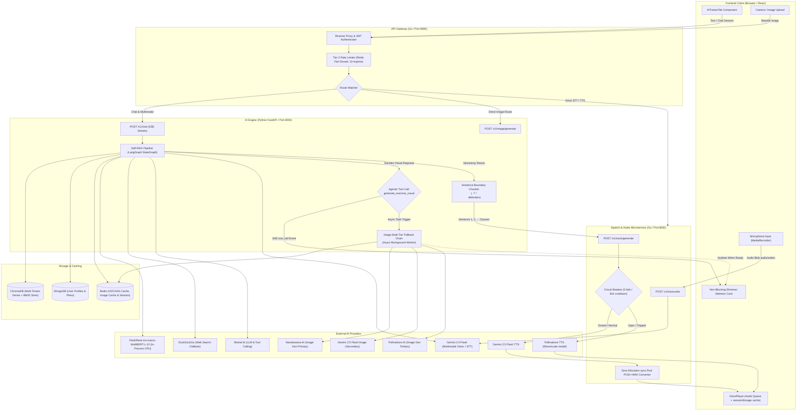
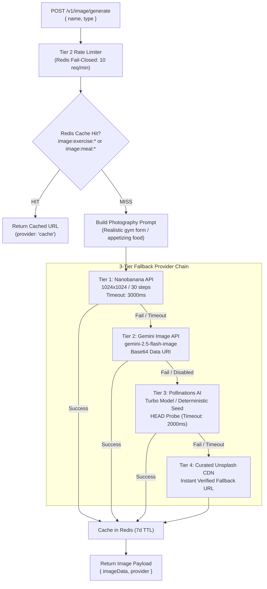

# ZenFit — AI Engine Service & RabbitMQ Workers (Phase 3)

High-performance Python / FastAPI microservice and background worker cluster responsible for LangGraph Self-RAG, ChromaDB vector indexing, and asynchronous LLM workout & nutrition plan synthesis.

---

## 1. Architectural Highlights

- **Asynchronous Request-Reply (HTTP 202 Accepted)**:
  - `POST /v1/plan/generate` validates user biometrics and goals, enforces distributed idempotency via Redis locks (`idempotency:plan:{userId}:{key}`), and enqueues to RabbitMQ `q.plans` in **< 20ms**.
- **Resilient Worker Cluster (`worker.py`)**:
  - Pulls tasks from `q.plans` with bounded concurrency (`prefetch_count`).
  - Executes CSCS-certified prompt calculations (Mifflin-St Jeor TDEE formulas) and Mistral structured plan generation.
  - Writes completed plan to MongoDB `user_plans` collection.
  - Purges stale user RAG caches in Redis.
  - Broadcasts `{ "type": "job_completed" }` event to Redis Pub/Sub channel `events:{userId}`, delivered in real time to the browser via the Go Gateway's embedded SSE Hub.
  - **Strict ACK Sequencing**: Message `basic_ack` occurs **strictly after** MongoDB write and Redis publish succeed, preventing silent job drops.
  - **Poison-Pill Mitigation & DLQ**: 3x exponential backoff retries before routing dead messages to `q.plans.dlq` with failure notifications.
- **Next-Gen Agentic Self-RAG & Multi-Tenant Caching Pipeline**:
  - **Decoupled Semantic Retrieval Cache (Passage-ID Pointers):** Global Redis VSS (`@scope:{public}`, cosine similarity $\ge 0.92$) caches verified scientific document IDs, bypassing ChromaDB, BM25, and Cross-Encoder reranking ($150\text{ms}-250\text{ms}$ saved).
  - **Retirement of Conversational L1 Exact Hashing:** Exact-string caching is retired for chat turns (which suffer from $<2\%$ hit rates, temporal drift, and multi-turn blindness) and preserved exclusively for API idempotency locks and static UI chips.
  - **Zero-Leak Context Hydration:** Personal biometrics (weight, age, injuries, meal plan) are never stored in the shared cache, but dynamically hydrated from MongoDB during generation.
  - **Parallel Hybrid Retrieval Engine:** Combines dense vectors (`bge-base-en-v1.5`) and sparse BM25 with Reciprocal Rank Fusion (RRF), decomposing compound queries and applying step-back prompting.
  - **Parent-Child Chunk Hydration:** Small 128-token child search needles hydrate into 512–1024 token parent blocks for rich contextual grounding.
  - **Sub-25ms Multilingual Reranking with FlashRank (`ms-marco-MultiBERT-L-12`):** In-process CPU-native ONNX cross-encoder (~150MB, 100+ languages) without heavy PyTorch dependencies. Evaluates candidate chunks with a calibrated confidence threshold ($\ge 0.65$), automatically triggering DuckDuckGo/PubMed web search fallback when internal retrieval confidence drops.
  - **Real-Time Streaming & Sentence-Boundary TTS:** Streams tokens via HTTP/2 SSE (`POST /v1/chat`), chunking at sentence boundaries to start audio playback in the Go Speech Service in **< 500ms TTFT**.
- **Circuit Breakers**:
  - Third-party AI APIs (Mistral, Gemini, Pollinations) protected with circuit breakers to prevent thread pool starvation during external outages.

---

## 2. API Endpoints

| Method | Endpoint | Description | Latency Profile |
|--------|----------|-------------|-----------------|
| `GET` | `/health/live` | Process liveness probe | < 2ms |
| `GET` | `/health/ready` | Datastore readiness probe (Redis, RabbitMQ, Chroma) | < 10ms |
| `POST` | `/v1/plan/generate` | Asynchronous plan generation (returns HTTP 202) | < 20ms |
| `GET` | `/v1/plan/jobs/{id}` | Fallback polling for plan status reconciliation | < 5ms |
| `POST` | `/v1/chat` | AI Trainer Chat & Self-RAG (JSON or SSE stream) | 200ms TTFT |
| `POST` | `/v1/image/generate` | Exercise & meal photograph synthesis (3-tier fallback) | Sub-second |
| `GET` | `/v1/quote` | Daily motivational quote (cached in Redis) | < 2ms |
| `POST` | `/v1/quote/personalized` | Personalized motivation quote | < 200ms |
| `POST` | `/v1/documents` | Ingest guidelines and documents into ChromaDB | Batch |

---

## 3. Architecture Diagrams

### 3.1 Next-Gen Agentic Self-RAG & Multi-Tenant Caching Pipeline (LLD)

The AI Trainer uses an **Agentic Self-RAG** workflow with **Multi-Tenant Semantic Retrieval Caching**, designed for sub-500ms Time-To-First-Token (TTFT), hybrid dense/sparse recall, and zero cross-tenant biometric leakage:

```mermaid
flowchart TD
    UserQuery["User Input (Text or Voice STT)"] --> IntentRouter{"Intent & Modality Router"}

    %% Fast Cache Paths
    IntentRouter -->|Preset Chip Clicked| StaticChipCache["Static Preset Cache\n(Keyed by chipId in Redis)\nReturns curated response (<5ms)"]
    IntentRouter -->|Natural Chat Turn| SemRetrievalCache{"Global Semantic Retrieval Cache\nRedis VSS (@scope:public)\nCosine Distance D <= 0.08\n(Similarity >= 0.92)"}

    SemRetrievalCache -->|Cache HIT on Doc IDs| BypassRetrieval["Bypass Heavy Retrieval Engine!\nInstantly hydrate Passages #14, #28, #42\n(Saves 150ms-250ms & 100% rerank compute)"]

    %% Phase 1: Upfront Query Translation
    SemRetrievalCache -->|Cache MISS| UpfrontRouter{"PHASE 1: Upfront Query Translation Router\n(Lightweight Structured JSON Model <35ms)"}

    UpfrontRouter -->|Direct Clean Query| CleanQ["Direct Clean Search\n(Strips conversational filler)"]
    UpfrontRouter -->|Colloquial / Slang| RAGFusion["RAG-Fusion Multi-Query\nGenerates 3 orthogonal scientific queries"]
    UpfrontRouter -->|Multi-Intent / Compound| Decomp["Query Decomposition\nSplits into Sub-Query A (Diet) + B (Training)"]
    UpfrontRouter -->|Kinetic Symptom / Pain| StepBack["Step-Back Prompting\nGenerates Specific Symptom + Foundational Principle"]

    %% Parallel Hybrid Retrieval
    subgraph ParallelHybridEngine["Parallel Hybrid Search Execution (ChromaDB Cluster)"]
        CleanQ --> AsyncGather["asyncio.gather Parallel Dispatch"]
        RAGFusion --> AsyncGather
        Decomp --> AsyncGather
        StepBack --> AsyncGather

        AsyncGather --> DenseSearch["Dense Vector Search\n(bge-base-en-v1.5, 768-dim, Top-K: 15)\nSemantic concept matching"]
        AsyncGather --> SparseSearch["Sparse BM25 Search\n(Exact tokens, RPE, exercise names, Top-K: 15)\nKeyword fidelity"]

        DenseSearch --> RRF["Reciprocal Rank Fusion (RRF, k=60)\nRRF_Score = sum(1 / (60 + rank))"]
        SparseSearch --> RRF

        RRF --> DedupeParent["Deduplicated Parent Hydration\nChild needle (64-128t) -> Parent block (512-1024t)\nRedis docstore: doc:parent:{id}"]
    end

    %% Cross-Encoder Evaluation
    DedupeParent --> CrossEncoder["FlashRank Multilingual Cross-Encoder\n(ms-marco-MultiBERT-L-12, max_length=128)\nIn-Process CPU ONNX Inference (<25ms)"]

    CrossEncoder --> ConfidenceGate{"Top Candidate Score >= 0.65?"}

    ConfidenceGate -->|Yes: Confident| StoreCache["Store Query Vector -> Passage IDs in Redis VSS\nTTL: 7 days (@scope:public)"]

    %% Phase 2: Adaptive Re-Retrieval Ladder
    ConfidenceGate -->|No: Score < 0.65| LadderRouter{"PHASE 2: Adaptive Re-Retrieval Ladder\nRetry Attempt Counter"}

    subgraph AdaptiveLadder["Adaptive Self-Reflective Re-Retrieval Ladder"]
        LadderRouter -->|Attempt 1 (Retry = 0)| Round1Rewrite["Round 1: Vocabulary & MeSH Taxonomy Shift\nTranslates slang to NSCA/MeSH clinical terms\n(e.g., winged scapula -> serratus anterior activation)"]
        Round1Rewrite --> CheckCacheR1{"Redis VSS Cache Check\non Canonical Query?"}
        CheckCacheR1 -->|HIT| BypassRetrieval
        CheckCacheR1 -->|MISS| RerunChroma1["Rerun Parallel Hybrid Search on ChromaDB"]
        RerunChroma1 --> CrossEncoder1["FlashRank Cross-Encoder Check"]
        CrossEncoder1 --> GateR1{"Score >= 0.65?"}

        GateR1 -->|Yes| StoreCache
        GateR1 -->|No| PlateauCheck{"Plateau Detection\nDelta Score >= +0.05?"}

        PlateauCheck -->|No: Score Stagnated| WebSynthesizer
        PlateauCheck -->|Yes: Score Improved| Round2Rewrite["Round 2: Step-Back Concept Relaxation\nRelaxes machine/rep constraints to retrieve\nroot kinetic stabilization principles"]
        Round2Rewrite --> RerunChroma2["Rerun Parallel Hybrid Search on ChromaDB"]
        RerunChroma2 --> CrossEncoder2["FlashRank Cross-Encoder Check"]
        CrossEncoder2 --> GateR2{"Score >= 0.65?"}
        GateR2 -->|Yes| StoreCache
        GateR2 -->|No: Exhausted| WebSynthesizer
    end

    %% Web Fallback
    subgraph WebFallbackEngine["Context-Aware Web Search Fallback"]
        WebSynthesizer["Web Query Synthesizer Node\nFormulates Boolean Clinical Search Query\n(User Intent + Missing Entity + Active Injury)"]
        WebSynthesizer --> ExternalSearch["DuckDuckGo / PubMed API\nScrapes top-3 authoritative abstracts"]
        ExternalSearch --> FlashRankWeb["FlashRank Reranks Web Abstracts"]
    end

    BypassRetrieval --> ContextAssembly
    StoreCache --> ContextAssembly
    FlashRankWeb --> ContextAssembly

    %% Generation & Output Orchestration
    subgraph GenerationLayer["Zero-Leak Context Assembly & Dual-Stream Output"]
        ContextAssembly["Zero-Leak Dynamic Context Assembly:\n1. Hydrated Scientific Passages (Public)\n2. ACTIVE User Profile (MongoDB live lookup)\n3. Bounded Recent 6-8 Turn Chat History\n4. CSCS Safety & Biomechanical Guardrails"]
        
        ContextAssembly --> StreamingLLM["Streaming LLM Generator\n(Gemini 2.5 Flash / Mistral Small)\nHTTP/2 SSE Token Stream"]

        StreamingLLM --> ToolCheck{"Visual Demonstration Needed?\n(Biomechanical cue or meal)"}
        
        ToolCheck -->|Yes: Tool Call| ToolCallEvent["SSE event: tool_call\ngenerate_exercise_visual(item, category, focus)"]
        ToolCallEvent --> ShimmerSkeleton["Frontend mounts instant Non-Blocking Shimmer Skeleton Card"]
        ToolCallEvent --> ImgChain["Async 4-Tier Image Fallback Worker\n(Nanobanana -> Gemini -> Pollinations -> SVG/CDN)"]
        ImgChain -.->|Hydrate When Ready| ShimmerSkeleton
        
        ToolCheck -->|Continuous Token Stream| SentenceBuffer["Sentence-Boundary Chunking Buffer\nSplits on (. ? ! \n) delimiters"]
        SentenceBuffer --> GoTTS["Go Speech Microservice (POST /v1/voice/generate)\nsync.Pool Zero-Allocation PCM->WAV Synthesizer\nSub-500ms TTFA audio queue in browser"]
    end

    subgraph InvalidationLifecycle["6. Event-Driven Cache Invalidation Lifecycle"]
        UserUpdates["User updates workout plan / biometrics in MongoDB"] --> RabbitMQEvent["RabbitMQ Event: user.plan.updated"]
        RabbitMQEvent --> EvictUser["Evict private user caches: DEL cache:rag:user_{userId}:*\n(Global science & passage cache preserved intact)"]
    end
```

#### Key Architectural Principles:
1. **Parent-Child (Small-to-Big) Chunking Schema:**
   * **Child Chunks (64–128 tokens):** Stored as dense and sparse vectors in ChromaDB. High cosine similarity because embedding representation is sharp and undiluted.
   * **Parent Chunks (512–1,024 tokens):** Full exercise or nutrition protocols (Target muscles, setup, execution, mistakes, and contraindications) stored in Redis docstore (`doc:parent:{parent_id}`).
   * **Deduplication:** When multiple child chunks belonging to the same parent are retrieved, the resolver deduplicates by `parent_id`, eliminating duplicate context window token waste.
2. **ChromaDB Offloaded Hybrid Search (Dense + Sparse):**
   * Dense and sparse BM25 indexing are centrally co-located in ChromaDB rather than split across external ad-hoc in-memory processes.
   * Captures both high-level semantic intent (*"build chest"* $\rightarrow$ *"pectoralis major"*) and exact keyword/metric terms (*"RPE 8"*, *"Zercher squat"*, *"Mifflin-St Jeor"*).
   * Merged via **Reciprocal Rank Fusion (RRF)**: $RRF(d) = \sum_{m \in \{dense, sparse\}} \frac{1}{60 + \text{rank}_m(d)}$.
3. **FlashRank Multilingual Cross-Encoder Reranking (`ms-marco-MultiBERT-L-12`):**
   * **Ultra-Lite ONNX Runtime:** Uses [FlashRank](https://github.com/PrithivirajDamodaran/FlashRank.git) running directly on CPU without PyTorch or Transformers dependencies. Eliminates 2.5GB+ Docker image bloat and operates at ~80MB RAM footprint.
   * **100+ Language Support:** Standardized on `ms-marco-MultiBERT-L-12` (~150MB), enabling high-fidelity reranking for international users in English, Spanish, Hindi, German, French, etc.
   * **Token Density Optimization:** Configured with `max_length=128`, matching our 64–128 token child chunks to avoid wasted attention matrix FLOPs, achieving sub-25ms CPU inference.
   * **Calibrated Confidence Gate ($\tau \ge 0.65$):** Acts as a statistical circuit breaker against hallucinations. If top candidate score $< 0.65$, automatically triggers DuckDuckGo/PubMed fallback search instead of generating off weak context.
4. **Retirement of Conversational L1 Exact Hashing:** Natural chat inputs vary significantly in phrasing, punctuation, and STT noise. Exact hashing (`sha256(message)`) has a <2% organic hit rate and causes severe temporal blindness (e.g., serving Monday's dinner plan on Thursday) and multi-turn blindness (*"Can I do 4 sets instead?"*). Exact caching is restricted strictly to **API mutation idempotency** (`idempotency:plan:{userId}:{key}`) and **static preset UI chips**.
5. **Global Semantic Retrieval Caching (Passage-ID Pointers via Redis VSS):**
   * **HNSW Index Specification:** Uses RediSearch `idx:rag_cache` with an HNSW vector index ($M=16$, $EF_{\text{construction}}=200$, 768 dimensions for `bge-base-en-v1.5`) querying `@scope:{public}`.
   * **Distance Thresholding:** Redis VSS returns Cosine Distance ($D = 1 - \text{similarity}$). Enforcing a distance cutoff of $D \le 0.08$ guarantees $\ge 0.92$ Cosine Similarity, bypassing ChromaDB, BM25, and FlashRank reranking ($150\text{ms}-250\text{ms}$ savings).
   * **Rolling TTL & Memory Management:** Pre-scored Parent Passage IDs are stored in Redis Hashes with a 7-day TTL (`EXPIRE 604800`). Zero personal user biometrics are stored in this shared index.
6. **Non-Blocking Eviction & Zero-Leak Context Assembly:**
   * **Non-Blocking Invalidation:** Event-driven invalidation via RabbitMQ (`user.plan.updated`) uses `SCAN` + `UNLINK` in batches of 100, eliminating single-threaded Redis event loop freezes caused by anti-pattern `KEYS` commands.
   * **Zero-Leak Dynamic Context Assembly:** Personal biometrics (weight, age, dietary restrictions, active injuries) are never stored in the shared cache, but dynamically hydrated from MongoDB during the generation step, guaranteeing 100% tenant privacy and plan freshness.
7. **Sentence-Boundary Pipelined Streaming TTS (Sub-500ms TTFA):**
   * **Problem Solved (Dead Silence & Phonetic Clipping):** In conversational voice interfaces, awaiting full LLM completion (250–400 tokens) introduces 3.5s–5.0s of dead silence, destroying conversational rhythm and causing user drop-off. Conversely, naive word- or character-level streaming sends fragmented phonemes to the TTS engine, producing robotic pitch glitches, broken prosody, and unnatural acoustic pauses.
   * **Architectural Decision:** Implemented a sentence-boundary chunking buffer that intercepts the LLM SSE token stream and flushes discrete grammatical clauses upon encountering sentence terminators (`.`, `?`, `!`, `\n`). Sentence #1 is dispatched asynchronously to the Go Speech Service (`POST /v1/voice/generate`), initiating audio playback in the browser within **400–600ms** while subsequent sentences synthesize in parallel. Chunks are cached in browser `sessionStorage` (`zenfit:voice:{hash}`) and server Redis for instantaneous zero-latency replay.
8. **Agentic Tool-Calling for Visual Assets & Non-Blocking Skeleton Hydration:**
   * **Problem Solved (Brittle Regex & Token Stream Blocking):** Legacy client-side regex matching (`shouldGenerateImage(text)`) suffers from high false-positive rates (triggering expensive image generation on passing conversational mentions) and false negatives (failing on implicit cues like *"illustrate proper elbow flare"*). Crucially, synchronously awaiting external image generation (2–4 seconds) freezes the text stream, degrading user experience.
   * **Architectural Decision:** Replaced regex heuristics with an agentic LLM tool contract: `generate_exercise_visual(item_name: str, category: str, biomechanical_focus: str)`. When the LLM determines visual demonstration is pedagogically required, it emits a structured `tool_call` event in the SSE stream. The frontend instantly mounts an animated shimmer skeleton card and continues streaming text tokens without blocking. The AI Engine processes the 3-tier fallback chain (Nanobanana $\rightarrow$ Gemini $\rightarrow$ Pollinations $\rightarrow$ SVG/CDN) in the background and hydrates the card asynchronously upon completion.
9. **Upfront Hybrid Query Translation Routing & Intent Decomposition (Phase 1 Pre-Retrieval):**
   * **Problem Solved (Garbage-In Garbage-Out, Slang & Compound Confusion):** Natural language gym queries exhibit high variance, containing colloquial gym slang (*"how to get cannonball delts"*, *"fix chicken legs"*), compound orthogonal intents (*"give me a 4-day PPL split and what to eat to cut 5kg"*), or symptom confusion (*"why do my knees pinch at bottom of squat"*). Passing raw unstructured conversational strings directly into vector search dilutes dense vector representations, floods BM25 with conversational noise, and destroys retrieval recall.
   * **Architectural Decision:** Implemented an upfront structured translation node (`QueryTranslationPlan` executed via lightweight SLM/LLM in <35ms) before any vector search occurs. The node classifies intent and routes queries into 4 execution paths:
     1. `direct`: Strips conversational filler (*"hey coach can you tell me"*) and extracts core fitness entities.
     2. `rag_fusion`: For gym slang or vernacular, generates 3 orthogonal scientific search expressions and fuses retrieval candidate needles via Reciprocal Rank Fusion (RRF, $k=60$).
     3. `decomposition`: Deconstructs multi-intent compound queries into independent sub-queries (e.g., Sub-Query A: Nutrition + Sub-Query B: Biomechanics), running parallel ChromaDB retrieval via `asyncio.gather`.
     4. `step_back`: For complex kinetic symptoms, generates both the specific symptom needle and the foundational kinetic principle (e.g., patellofemoral joint mechanics & ankle dorsiflexion mobility).
10. **Adaptive Self-Reflective Re-Retrieval Ladder & Context-Aware Web Fallback (Phase 2 Post-Retrieval):**
    * **Problem Solved (Binary Retry Blindness, Semantic Drift & Infinite Loops):** A naive binary boolean flag (`retry = true`) is overly brittle, failing over to external web search after just 1 retry without exploring alternative linguistic formulations. Conversely, unconstrained retry loops suffer from semantic drift (warping queries over 4+ iterations until false-positive documents match unrelated exercises) and severe latency bloat (>1,000ms).
    * **Architectural Decision:** Implemented a bounded **Adaptive 3-Round Strategy Ladder** (Max 2 retries / 3 total attempts) with intelligent circuit breakers:
      * **Round 0 (Baseline):** Upfront translated hybrid search (RRF $k=60$) evaluated by FlashRank cross-encoder. If top candidate score $\ge 0.65$, proceeds immediately to Context Assembly.
      * **Round 1 (Vocabulary / MeSH Taxonomy Shift):** If score $< 0.65$, translates colloquial entities into formal NSCA/MeSH clinical exercise physiology terminology (e.g., *"winged shoulder blades"* $\rightarrow$ *"scapular winging serratus anterior activation horizontal press"*). Reruns ChromaDB hybrid search.
      * **Round 2 (Structural Step-Back Relaxation):** If score $< 0.65$ and the score improved from Round 0 ($\Delta \text{score} \ge +0.05$), relaxes specific equipment/rep constraints to retrieve core kinetic stabilization principles.
      * **3 Intelligent Circuit Breakers:**
        1. *Plateau Breaker:* If $\Delta \text{score} < +0.05$ between rounds, terminates internal retrieval immediately (detects internal knowledge deficit).
        2. *Hard Latency Budget:* Strict 220ms cap on total retrieval phase.
        3. *Redis VSS Canonical Query Cache:* Canonicalized rewrites check Redis VSS first to hit previously cached queries in <5ms.
      * **Context-Aware Web Search Fallback Formulation:** When internal retrieval fails or plateau is detected, the **Web Query Synthesizer Node** extracts user intent, the specific missing knowledge gap, and active user injuries into a clinical search engine syntax $\rightarrow$ queries DuckDuckGo/PubMed $\rightarrow$ scrapes top-3 abstracts $\rightarrow$ FlashRank verifies $\rightarrow$ passes to Generator with explicit citations `[Source: Clinical Web Search]`.

#### Detailed Latency & Compute Budget Comparison

| Processing Stage | Traditional Naive RAG | Next-Gen Hybrid Self-RAG (Cache MISS) | Next-Gen Hybrid Self-RAG (Cache HIT) |
|---|---|---|---|
| **L1 Exact String Check** | 2 ms (almost always misses) | **Bypassed** (0 ms penalty) | **Bypassed** (0 ms penalty) |
| **Semantic Cache Lookup** | — | 6 ms (Redis VSS miss) | **5 ms (Redis VSS Passage Hit)** |
| **Query Translation & Expansion** | — | 35 ms (Parallel async sub-queries) | **Bypassed** (0 ms) |
| **Vector & BM25 Hybrid Retrieval** | 80 ms (Flat ChromaDB) | 45 ms (Parallel Dense + BM25) | **Bypassed** (0 ms) |
| **Parent-Child Hydration** | — | 8 ms | **Bypassed** (0 ms) |
| **FlashRank Multilingual Reranking** | 1,200 ms (Batched LLM grading) | **18 ms** (`ms-marco-MultiBERT-L-12`) | **Bypassed** (0 ms) |
| **Live Context Hydration** | 15 ms (MongoDB lookup) | 12 ms (MongoDB indexed fetch) | 12 ms (MongoDB indexed fetch) |
| **Time-to-First-Token (TTFT)** | ~1,500 ms | **~220 ms** | **~120 ms** |
| **Time-to-First-Audio (TTFA)** | ~3,800 ms (Waits for full text) | **~500 ms (Sentence #1 stream)** | **~380 ms (Sentence #1 stream)** |

---

### 3.2 Multimodal Chatbot System Flow

End-to-end integration between the chat UI, API Gateway, AI Engine, and external multimodal models:



### 3.2.1 End-to-End Self-RAG Retrieval & Adaptive Query Translation Engine Flowchart

Detailed multi-stage state machine combining Phase 1 Upfront Translation, ChromaDB Hybrid Search, Deduplicated Parent Hydration, FlashRank Cross-Encoder, Phase 2 Adaptive Re-Retrieval Ladder, and Dynamic Context Assembly:

```mermaid
flowchart TD
    UserQuery["User Input (Text or Voice STT)"] --> IntentRouter{"Intent & Modality Router"}

    %% Fast Cache Paths
    IntentRouter -->|Preset Chip Clicked| StaticChipCache["Static Preset Cache\n(Keyed by chipId in Redis)\nReturns curated response (<5ms)"]
    IntentRouter -->|Natural Chat Turn| SemRetrievalCache{"Global Semantic Retrieval Cache\nRedis VSS (@scope:public)\nCosine Distance D <= 0.08\n(Similarity >= 0.92)"}

    SemRetrievalCache -->|Cache HIT on Doc IDs| BypassRetrieval["Bypass Heavy Retrieval Engine!\nInstantly hydrate Passages #14, #28, #42\n(Saves 150ms-250ms & 100% rerank compute)"]

    %% Phase 1: Upfront Query Translation
    SemRetrievalCache -->|Cache MISS| UpfrontRouter{"PHASE 1: Upfront Query Translation Router\n(Lightweight Structured JSON Model <35ms)"}

    UpfrontRouter -->|Direct Clean Query| CleanQ["Direct Clean Search\n(Strips conversational filler)"]
    UpfrontRouter -->|Colloquial / Slang| RAGFusion["RAG-Fusion Multi-Query\nGenerates 3 orthogonal scientific queries"]
    UpfrontRouter -->|Multi-Intent / Compound| Decomp["Query Decomposition\nSplits into Sub-Query A (Diet) + B (Training)"]
    UpfrontRouter -->|Kinetic Symptom / Pain| StepBack["Step-Back Prompting\nGenerates Specific Symptom + Foundational Principle"]

    %% Parallel Hybrid Retrieval
    subgraph ParallelHybridEngine["Parallel Hybrid Search Execution (ChromaDB Cluster)"]
        CleanQ --> AsyncGather["asyncio.gather Parallel Dispatch"]
        RAGFusion --> AsyncGather
        Decomp --> AsyncGather
        StepBack --> AsyncGather

        AsyncGather --> DenseSearch["Dense Vector Search\n(bge-base-en-v1.5, 768-dim, Top-K: 15)\nSemantic concept matching"]
        AsyncGather --> SparseSearch["Sparse BM25 Search\n(Exact tokens, RPE, exercise names, Top-K: 15)\nKeyword fidelity"]

        DenseSearch --> RRF["Reciprocal Rank Fusion (RRF, k=60)\nRRF_Score = sum(1 / (60 + rank))"]
        SparseSearch --> RRF

        RRF --> DedupeParent["Deduplicated Parent Hydration\nChild needle (64-128t) -> Parent block (512-1024t)\nRedis docstore: doc:parent:{id}"]
    end

    %% Cross-Encoder Evaluation
    DedupeParent --> CrossEncoder["FlashRank Multilingual Cross-Encoder\n(ms-marco-MultiBERT-L-12, max_length=128)\nIn-Process CPU ONNX Inference (<25ms)"]

    CrossEncoder --> ConfidenceGate{"Top Candidate Score >= 0.65?"}

    ConfidenceGate -->|Yes: Confident| StoreCache["Store Query Vector -> Passage IDs in Redis VSS\nTTL: 7 days (@scope:public)"]

    %% Phase 2: Adaptive Re-Retrieval Ladder
    ConfidenceGate -->|No: Score < 0.65| LadderRouter{"PHASE 2: Adaptive Re-Retrieval Ladder\nRetry Attempt Counter"}

    subgraph AdaptiveLadder["Adaptive Self-Reflective Re-Retrieval Ladder"]
        LadderRouter -->|Attempt 1 (Retry = 0)| Round1Rewrite["Round 1: Vocabulary & MeSH Taxonomy Shift\nTranslates slang to NSCA/MeSH clinical terms\n(e.g., winged scapula -> serratus anterior activation)"]
        Round1Rewrite --> CheckCacheR1{"Redis VSS Cache Check\non Canonical Query?"}
        CheckCacheR1 -->|HIT| BypassRetrieval
        CheckCacheR1 -->|MISS| RerunChroma1["Rerun Parallel Hybrid Search on ChromaDB"]
        RerunChroma1 --> CrossEncoder1["FlashRank Cross-Encoder Check"]
        CrossEncoder1 --> GateR1{"Score >= 0.65?"}

        GateR1 -->|Yes| StoreCache
        GateR1 -->|No| PlateauCheck{"Plateau Detection\nDelta Score >= +0.05?"}

        PlateauCheck -->|No: Score Stagnated| WebSynthesizer
        PlateauCheck -->|Yes: Score Improved| Round2Rewrite["Round 2: Step-Back Concept Relaxation\nRelaxes machine/rep constraints to retrieve\nroot kinetic stabilization principles"]
        Round2Rewrite --> RerunChroma2["Rerun Parallel Hybrid Search on ChromaDB"]
        RerunChroma2 --> CrossEncoder2["FlashRank Cross-Encoder Check"]
        CrossEncoder2 --> GateR2{"Score >= 0.65?"}
        GateR2 -->|Yes| StoreCache
        GateR2 -->|No: Exhausted| WebSynthesizer
    end

    %% Web Fallback
    subgraph WebFallbackEngine["Context-Aware Web Search Fallback"]
        WebSynthesizer["Web Query Synthesizer Node\nFormulates Boolean Clinical Search Query\n(User Intent + Missing Entity + Active Injury)"]
        WebSynthesizer --> ExternalSearch["DuckDuckGo / PubMed API\nScrapes top-3 authoritative abstracts"]
        ExternalSearch --> FlashRankWeb["FlashRank Reranks Web Abstracts"]
    end

    BypassRetrieval --> ContextAssembly
    StoreCache --> ContextAssembly
    FlashRankWeb --> ContextAssembly

    %% Generation & Output Orchestration
    subgraph GenerationLayer["Zero-Leak Context Assembly & Dual-Stream Output"]
        ContextAssembly["Zero-Leak Dynamic Context Assembly:\n1. Hydrated Scientific Passages (Public)\n2. ACTIVE User Profile (MongoDB live lookup)\n3. Bounded Recent 6-8 Turn Chat History\n4. CSCS Safety & Biomechanical Guardrails"]
        
        ContextAssembly --> StreamingLLM["Streaming LLM Generator\n(Gemini 2.5 Flash / Mistral Small)\nHTTP/2 SSE Token Stream"]

        StreamingLLM --> ToolCheck{"Visual Demonstration Needed?\n(Biomechanical cue or meal)"}
        
        ToolCheck -->|Yes: Tool Call| ToolCallEvent["SSE event: tool_call\ngenerate_exercise_visual(item, category, focus)"]
        ToolCallEvent --> ShimmerSkeleton["Frontend mounts instant Non-Blocking Shimmer Skeleton Card"]
        ToolCallEvent --> ImgChain["Async 4-Tier Image Fallback Worker\n(Nanobanana -> Gemini -> Pollinations -> SVG/CDN)"]
        ImgChain -.->|Hydrate When Ready| ShimmerSkeleton
        
        ToolCheck -->|Continuous Token Stream| SentenceBuffer["Sentence-Boundary Chunking Buffer\nSplits on (. ? ! \n) delimiters"]
        SentenceBuffer --> GoTTS["Go Speech Microservice (POST /v1/voice/generate)\nsync.Pool Zero-Allocation PCM->WAV Synthesizer\nSub-500ms TTFA audio queue in browser"]
    end
```

### 3.3 Image Generation Fallback Chain (`POST /v1/image/generate`)



### 3.4 Speech Transcription (STT) & Voice Generation (TTS)

```mermaid
flowchart TD
    subgraph STT["Speech-to-Text (POST /v1/transcribe)"]
        AudioInput["User Voice Audio (audio/webm, max 5MB)"] --> STTHandler["Speech Service / Go Transcribe"]
        STTHandler --> GeminiAudio["Gemini Multimodal (gemini-2.0-flash-exp)"]
        GeminiAudio --> TextOutput["Transcribed Text Input"]
    end

    subgraph TTS["Text-to-Speech (POST /v1/voice/generate)"]
        TextPrompt["Text to Synthesize & Voice Name"] --> ClientCache{"Client sessionStorage Hit?<br/>zenfit:voice:{hash}"}
        ClientCache -->|HIT| PlayDirect["Instant HTML5 Audio Playback"]
        ClientCache -->|MISS| GatewayRoute["Speech Service Route"]
        
        GatewayRoute --> CircuitBreaker{"Circuit Breaker State<br/>(Gemini TTS)"}
        CircuitBreaker -->|Closed / Normal| GeminiTTS["Primary: Gemini TTS<br/>gemini-2.5-flash-preview-tts<br/>Raw 24kHz 16-bit PCM"]
        GeminiTTS --> SyncPool["sync.Pool Zero-Allocation<br/>pcmToWav() RIFF Header Container"]
        
        GeminiTTS -->|Failures >= 5 / Timeout| Trip["Trip Breaker to OPEN<br/>(60s Cooldown)"]
        Trip --> PollinationsTTS
        CircuitBreaker -->|Open / Tripped| PollinationsTTS["Fallback: Pollinations TTS<br/>ElevenLabs Model / Nova Voice<br/>MP3 Audio Buffer (< 2s)"]
        
        SyncPool --> AudioResult["Return Binary WAV / Base64 JSON"]
        PollinationsTTS --> AudioResult
        AudioResult --> ClientCacheStore["Cache in Browser sessionStorage"]
        ClientCacheStore --> AudioPlay["Play in VoicePlayer Component"]
    end
```



---

## 4. Local Development & Setup

### 4.1 Dependency Installation & FlashRank Model Setup

FlashRank uses ONNX Runtime directly for CPU-accelerated inference without requiring PyTorch or HuggingFace Transformers.

```powershell
# 1. Install microservice dependencies (includes flashrank>=0.2.9)
pip install -r requirements.txt
pip install -r requirements-dev.txt

# 2. (Optional) Pre-warm FlashRank multilingual model cache
python -c "from flashrank import Ranker; Ranker(model_name='ms-marco-MultiBERT-L-12', cache_dir='/tmp/models')"

# 3. Run API server locally
uvicorn app.main:app --host 0.0.0.0 --port 8000 --reload

# 4. Run background RabbitMQ plan worker
python worker.py

# 5. Run test suite
pytest -v
```

### 4.2 FlashRank Integration Contract (`app/services/rerank_service.py`)

```python
from flashrank import Ranker, RerankRequest

class RerankService:
    def __init__(self):
        # Initializes ms-marco-MultiBERT-L-12 (~150MB, 100+ languages, CPU-only)
        self.ranker = Ranker(
            model_name="ms-marco-MultiBERT-L-12",
            max_length=128,  # Exactly tuned for our 64-128 token child chunks
            cache_dir="/tmp/models"
        )
        self.threshold = 0.65

    def rerank(self, query: str, passages: list[dict]) -> list[dict]:
        request = RerankRequest(query=query, passages=passages)
        results = self.ranker.rerank(request)
        return [r for r in results if r["score"] >= self.threshold]
```

### 4.3 Agentic Tool-Calling Contract (`generate_exercise_visual`)

Replaced brittle frontend regex matching (`shouldGenerateImage`) with native LLM function/tool calling. The LLM autonomously triggers visual demonstrations when pedagogically beneficial (e.g. complex compound movements or meal prep instructions), emitting non-blocking SSE `tool_call` events.

```python
from pydantic import BaseModel, Field

class GenerateExerciseVisualInput(BaseModel):
    item_name: str = Field(
        description="Canonical name of the exercise or meal item (e.g., 'Barbell Romanian Deadlift')"
    )
    category: str = Field(
        description="Category classification: 'exercise' or 'meal'"
    )
    biomechanical_focus: str = Field(
        description="Critical visual cues (e.g., 'Hip hinge angle, neutral lumbar spine, bar over midfoot')"
    )

TOOL_GENERATE_VISUAL = {
    "type": "function",
    "function": {
        "name": "generate_exercise_visual",
        "description": "Generate an anatomical form demonstration or nutritional visual card when visual pedagogy is necessary.",
        "parameters": GenerateExerciseVisualInput.model_json_schema(),
    }
}
```

* **Client Non-Blocking Protocol:**
  1. The LLM invokes `generate_exercise_visual(...)`.
  2. The AI Engine flushes an SSE event: `event: tool_call\ndata: {"tool": "generate_exercise_visual", "call_id": "call_123", "args": {...}}`.
  3. The React client immediately renders a non-blocking shimmer skeleton card at the current cursor position.
  4. The LLM continues generating and streaming explanatory text tokens without interruption.
  5. The AI Engine dispatches the image generation task asynchronously to the 3-tier fallback worker and emits `event: tool_result` once the image asset is cached in Redis, hydrating the skeleton card seamlessly.

### 4.4 Sentence-Boundary Pipelined Streaming Buffer Contract

To achieve human conversational cadence (<500ms TTFA) in voice mode, the token generator feeds a delimiter-aware sentence accumulator rather than waiting for response termination:

```python
import re
from typing import AsyncGenerator

SENTENCE_DELIMITER_REGEX = re.compile(r'([.?!]+(?:\s+|$)|[\n]{2,})')

async def sentence_boundary_stream(
    token_generator: AsyncGenerator[str, None],
    speech_client
) -> AsyncGenerator[str, None]:
    """
    Buffers incoming LLM tokens and dispatches discrete completed sentences
    to the Go Speech Service asynchronously for immediate sub-500ms TTFA playback.
    """
    buffer = ""
    sentence_idx = 0

    async for token in token_generator:
        yield token  # Immediately stream text token to browser SSE client
        buffer += token

        # Split on complete sentence boundaries
        parts = SENTENCE_DELIMITER_REGEX.split(buffer)
        if len(parts) > 1:
            # Complete sentence clause assembled
            complete_sentence = parts[0].strip()
            if len(complete_sentence) > 3:
                # Dispatch sentence asynchronously to Go Speech Service (:8081)
                speech_client.dispatch_sentence_tts(
                    sentence_index=sentence_idx,
                    text=complete_sentence
                )
                sentence_idx += 1
            buffer = "".join(parts[1:])

    # Flush remaining trailing clause upon stream end
    if buffer.strip():
        speech_client.dispatch_sentence_tts(
            sentence_index=sentence_idx,
            text=buffer.strip()
        )
```

### 4.5 Upfront Query Translation Router Contract (`QueryTranslationPlan`)

Executed upfront (<35ms) before hitting ChromaDB or Redis. Formulates target dense and sparse queries tailored for hybrid retrieval and Reciprocal Rank Fusion:

```python
import asyncio
from typing import List, Literal
from pydantic import BaseModel, Field

class QueryTranslationPlan(BaseModel):
    route: Literal["direct", "rag_fusion", "decomposition", "step_back"] = Field(
        description="Selected routing mode based on ambiguity, vernacular, or multi-intent analysis"
    )
    reasoning: str = Field(description="Brief rationale for translation routing")
    search_queries: List[str] = Field(
        min_length=1,
        max_length=3,
        description="Target search queries optimized for dense embedding and BM25 token matching"
    )
    extracted_entities: List[str] = Field(
        description="Key biomechanical, anatomical, and nutritional entities extracted"
    )

async def execute_upfront_hybrid_search(
    plan: QueryTranslationPlan,
    chroma_service,
    k: int = 15
) -> list[dict]:
    """
    Executes all translated search queries in parallel via asyncio.gather
    and fuses the candidate child chunks using Reciprocal Rank Fusion (k=60).
    """
    # 1. Parallel dispatch across ChromaDB hybrid dense + sparse BM25 indices
    search_coros = [
        chroma_service.hybrid_search(query=q, top_k=k)
        for q in plan.search_queries
    ]
    multi_results = await asyncio.gather(*search_coros)

    # 2. Reciprocal Rank Fusion (RRF, k=60)
    rrf_scores = {}
    doc_map = {}
    for query_result in multi_results:
        for rank, doc in enumerate(query_result):
            doc_id = doc["id"]
            doc_map[doc_id] = doc
            rrf_scores[doc_id] = rrf_scores.get(doc_id, 0.0) + (1.0 / (60.0 + (rank + 1)))

    sorted_doc_ids = sorted(rrf_scores.keys(), key=lambda did: rrf_scores[did], reverse=True)
    return [doc_map[did] for did in sorted_doc_ids[:k]]
```

### 4.6 Adaptive Re-Retrieval Ladder & Plateau Detection Contract

Engaged if initial retrieval scores below $\tau = 0.65$ FlashRank confidence. Enforces bounded retries, plateau detection, and canonical cache checks:

```python
import time
from typing import Optional, Tuple

class AdaptiveRetrievalLadder:
    def __init__(self, chroma_service, rerank_service, redis_vss_service, web_service):
        self.chroma = chroma_service
        self.reranker = rerank_service
        self.redis_vss = redis_vss_service
        self.web = web_service
        self.confidence_threshold = 0.65
        self.plateau_delta = 0.05
        self.sla_timeout_seconds = 0.220  # 220ms hard timeout

    async def execute_ladder(
        self,
        original_query: str,
        initial_candidates: list[dict],
        user_context: dict
    ) -> Tuple[list[dict], str]:
        start_time = time.perf_counter()

        # Step 0: Score Initial Pass
        r0_results = self.reranker.rerank(original_query, initial_candidates)
        top_score_r0 = r0_results[0]["score"] if r0_results else 0.0
        if top_score_r0 >= self.confidence_threshold:
            return r0_results, "round_0_direct"

        # Check Timeout SLA
        if (time.perf_counter() - start_time) > self.sla_timeout_seconds:
            return await self._fallback_to_web(original_query, user_context)

        # Step 1: Round 1 (Vocabulary / MeSH Taxonomy Shift)
        r1_query = await self._rewrite_mesh_taxonomy(original_query)
        
        # Check if canonical query hits Redis VSS
        vss_hit = await self.redis_vss.find_similar_passages(r1_query, threshold_distance=0.08)
        if vss_hit:
            return vss_hit, "round_1_vss_cache"

        r1_candidates = await self.chroma.hybrid_search(r1_query, top_k=15)
        r1_results = self.reranker.rerank(r1_query, r1_candidates)
        top_score_r1 = r1_results[0]["score"] if r1_results else 0.0

        if top_score_r1 >= self.confidence_threshold:
            return r1_results, "round_1_mesh"

        # Plateau Breaker Check
        delta = top_score_r1 - top_score_r0
        if delta < self.plateau_delta:
            # Score stagnated or dropped: internal knowledge deficit detected
            return await self._fallback_to_web(original_query, user_context)

        # Check Timeout SLA
        if (time.perf_counter() - start_time) > self.sla_timeout_seconds:
            return await self._fallback_to_web(original_query, user_context)

        # Step 2: Round 2 (Structural Step-Back Concept Relaxation)
        r2_query = await self._rewrite_step_back_concept(original_query)
        r2_candidates = await self.chroma.hybrid_search(r2_query, top_k=15)
        r2_results = self.reranker.rerank(r2_query, r2_candidates)
        top_score_r2 = r2_results[0]["score"] if r2_results else 0.0

        if top_score_r2 >= self.confidence_threshold:
            return r2_results, "round_2_step_back"

        # Exhausted internal attempts -> Failover to Web
        return await self._fallback_to_web(original_query, user_context)

    async def _fallback_to_web(self, query: str, user_context: dict) -> Tuple[list[dict], str]:
        web_docs = await self.web.synthesize_and_search(query, user_context)
        return web_docs, "web_search_fallback"
```

### 4.7 Context-Aware Web Search Fallback Synthesizer Contract

Synthesizes high-density clinical/scientific Boolean search syntax when internal knowledge bases lack sufficient coverage:

```python
from pydantic import BaseModel, Field

class WebSearchQuerySynthesis(BaseModel):
    search_syntax: str = Field(
        description="Boolean clinical query (e.g., 'patellofemoral crepitus biomechanics Bulgarian split squat eccentric')"
    )
    domain_filter: Optional[str] = Field(
        default=None,
        description="Domain focus, e.g., 'pubmed' or 'sports_medicine'"
    )

async def synthesize_web_query_prompt(
    original_user_query: str,
    failed_retrieval_topic: str,
    active_injuries: list[str]
) -> str:
    """
    Constructs an authoritative Boolean search string tailored for DuckDuckGo
    or PubMed API querying, eliminating conversational noise.
    """
    injuries_str = ", ".join(active_injuries) if active_injuries else "None"
    return f"""Synthesize a high-precision search engine query for clinical exercise science.
User Question: "{original_user_query}"
Knowledgebase Gap: Missing {failed_retrieval_topic}
Active Injuries: {injuries_str}

Respond with a Boolean search string omitting all conversational filler:"""
```

